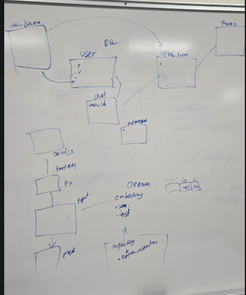
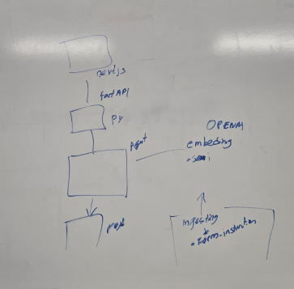

# ClearPath for Immigration

> **Disclaimer:** This project is a class project, not legal advice. Always confirm answers
> against the official instructions on [uscis.gov](https://www.uscis.gov) or with an immigration attorney.

## Project overview

### Purpose
Immigration paperwork is stressful, and one mistake can delay a case for months. The official USCIS instructions are
long PDFs full of legal terms: people say "green card" or "work permit", but the instructions say "adjustment of
status" and "employment authorization". ClearPath answers questions in plain words using only the official
instructions for Forms I-130, I-131, I-485 and I-765, shows the form, page and section each answer comes from, and
says "the instructions don't cover this" instead of guessing.


### Goals
| Goal                                                                                                                   | Status                                       |
|------------------------------------------------------------------------------------------------------------------------|----------------------------------------------|
| Answer questions from the official instructions, with citations (RAG with embeddings)                                  | Done: about 95% correct on 82 test questions |
| Measure everything: retrieval metrics, an LLM judge, and a hand check of the judge                                     | Done                                         |
| Web chat page                                                                                                          | Done: Next.js + FastAPI                      |
| Chat history: log in and come back to saved chats                                                                      | Done: PostgreSQL                             |
| Follow-up questions and small talk: a search agent with tool calling                                                   | Done: see "Search agent"                     |
| Form review: users upload a filled-out form and get a list of errors or missing information before sending it to USCIS | Planned                                      |

### Initial ERD
<!-- Add your ERD image: save it as docs/images/erd.png (or change the path below) -->


The tables for users, chat history and form review are in [`db/schema.sql`](db/schema.sql). The instruction passages
and their embeddings stay in Chroma and `data/index/chunks.jsonl`.

### System design
<!-- Add your system design image: save it as docs/images/system-design.png (or change the path below) -->


Browser (Next.js chat page) → Next.js server → FastAPI (Python) → search agent (GPT-4.1-mini decides whether to
call its search tool, which searches Chroma for the top 8 passages; it answers from them, and code checks the
citations) → reply with sources. PostgreSQL stores
users, login sessions and chats (and later the uploaded forms).

## Project log

| Date       | What                                                                                                                                                     | Hours |
|------------|----------------------------------------------------------------------------------------------------------------------------------------------------------|-------|
| 11/2/2026  | Chose the project and planned it; created the GitHub repo                                                                                                | 4     |
| 11/5/2026  | Downloaded the USCIS instruction PDFs; built PDF reading and section-aware chunking, with tests                                                          | 4     |
| 11/7/2026  | Built the evaluation set (31 topics, plain and jargon questions); compared keyword search with OpenAI embeddings in Chroma; first answers with citations | 4     |
| 11/14/2026 | Added query rewriting, hybrid search and a form filter (each measured); built the LLM-as-judge; full answer evaluation (95% correct)                     | 4     |
| 11/15/2026 | Checked the judge by hand (87% agreement); fixed a test-set mistake; added held-out questions (92% correct); fixed a chunking bug                        | 4     |
| 11/18/2026 | Built the web chat: FastAPI endpoint and Next.js page                                                                                                    | 4     |
| 11/19/2026 | Prepared the pitch; drew the system design and ERD; designed the PostgreSQL schema for chat history and form review                                      | 4     |
| 11/19/2026 | Built chat history: PostgreSQL in Docker, sign-up and log-in, saved chats with their sources, chat list in the web page                                   |       |
| 11/19/2026 | Replaced the fixed pipeline with a search agent (tool calling): follow-up questions and small talk; measured on 88 messages                               |       |
| **Total**  |                                                                                                                                                          | 4     |

## Problem

USCIS paperwork is repetitive and the guidance is scattered across long PDF instructions full of
specialized jargon ("EAD", "adjustment of status", "eligibility category (c)(9)", "A-Number").
Applicants re-type the same information on every form and struggle to find the answer to
form-specific questions, which leads to costly mistakes.

## What it does

1. **Form Q&A (core concept: Embeddings / RAG)** — answers questions about a form using only the
   official USCIS instructions, and cites the form, Part and edition date the answer came from.
   If the retrieved text doesn't support an answer, it says so instead of guessing.
2. **Chat history**: users log in, and their conversations are saved so they can come back to them.
3. **Form review** (planned): users upload a filled-out form and get a list of errors or missing information,
   each explained with the instruction it comes from, before they send it to USCIS.

## Retrieval design

USCIS instructions use jargon and exact codes that plain embedding search handles poorly, so
retrieval is built in layers, and each layer is measured against a test set of questions:

| Layer | Handles |
|---|---|
| Section-aware chunking with a context header (`Form I-765 > Part 2 > Item 27`) on every chunk | Chunks that make no sense out of context |
| LLM query rewriting using the USCIS glossary ("work permit" → "Employment Authorization Document, Form I-765") | Plain-language questions vs. official terms |
| Hybrid search: dense embeddings + BM25 keyword search, merged with reciprocal rank fusion | Exact codes and form numbers (`I-765`, `(c)(8)`) |
| Reranking the top candidates with a cross-encoder | Picking the best passage among close matches |

**Evaluation:** [`data/eval/eval_set.json`](data/eval/eval_set.json) has 31 answer targets across the four
forms. Each is asked twice, once in plain words ("Can I get permission to work while I wait?") and once in
USCIS jargon ("How do I file Form I-765 under category (c)(9)?"), so comparing the pair shows how much the
vocabulary gap hurts retrieval. The targets include harder cases on purpose: deadlines and numbers (t19, t25,
t26), negative questions such as "who may *not* file" (t27–t29), passages repeated in two places (t30), and
category-specific exceptions that override a general rule (t31 vs. t20). Five more questions aren't answered by
any loaded instructions (o01–o05; o04 and o05 are close to the topic, about fees and processing times) and test
whether the app admits it doesn't know. A held-out set (t32–t37 and o06–o08) was added after all tuning; see
"Held-out questions".

Answers are labeled with phrases copied from the official text, not chunk IDs, so the same labels work for any
chunking strategy: a chunk is relevant if it comes from the right form and contains one of the phrases.
Retrieval is scored by Recall@1, Recall@5 and MRR (mean reciprocal rank of the first relevant chunk in the top
10), overall and per question style.

```bash
# check that every target still matches a chunk (run after changing the chunker or the eval set)
.venv/Scripts/python -m immigration_helper.evaluation validate
# score keyword and embedding search; prints a table and saves results/retrieval-<timestamp>.json
.venv/Scripts/python -m immigration_helper.evaluation retrieval
# keyword search only (free, no API calls)
.venv/Scripts/python -m immigration_helper.evaluation retrieval --retrievers keyword
# answer every question and grade the answers with the LLM judge (about $0.45 for all 67 questions)
.venv/Scripts/python -m immigration_helper.evaluation answers
# a few questions only, or other settings
.venv/Scripts/python -m immigration_helper.evaluation answers --questions t01-plain o04 --passages 8 --form-filter
# write 15 saved answers to a CSV sheet to grade by hand, then compare your grades with the judge's (free)
.venv/Scripts/python -m immigration_helper.evaluation grading-sheet results/answers-20261114-201525.json
.venv/Scripts/python -m immigration_helper.evaluation agreement results/answers-20261114-201525.json
```

The embedding index is stored in `data/index/chroma` and rebuilt only when the chunks or the embedding model
change, so after the first run only the questions are embedded.

## Planned stack

- Python, `pymupdf` for PDF parsing
- OpenAI for both embeddings (`text-embedding-3-small`, compared against `-large`) and answer generation (`gpt-4.1-mini`)
- Vector store: Chroma (local)
- Keyword search: `rank_bm25`
- The API key is read from the `OPENAI_API_KEY` environment variable
- Web chat: FastAPI (Python API) + Next.js (page), see "Web chat"
- PostgreSQL (in Docker) for users, login sessions and chat history, via `psycopg`

## Getting started

```bash
python -m venv .venv
.venv/Scripts/pip install -r requirements.txt   # macOS/Linux: .venv/bin/pip
.venv/Scripts/python -m immigration_helper.ingestion   # chunks data/forms/*instr.pdf -> data/index/chunks.jsonl
.venv/Scripts/python -m pytest   # the PostgreSQL tests are skipped unless the database is running
```

## Web chat

PostgreSQL plus two servers, started from the project root. The OpenAI key stays in the Python process: the page
only talks to Next.js, which forwards `/api/*` to the Python API (a rewrite in `web/next.config.ts`).

```bash
docker compose up -d   # PostgreSQL on 127.0.0.1:5432; creates the tables from db/schema.sql the first time
```

```bash
.venv/Scripts/python -m immigration_helper.api   # Python API on http://127.0.0.1:8000
```

```bash
npm --prefix web install   # first time only (needs Node.js 20.9 or newer)
npm --prefix web run dev   # the chat page on http://localhost:3000
```

- **`immigration_helper/api/`** is the HTTP layer:

  | Endpoint | What it does |
  |---|---|
  | `POST /api/auth/signup`, `POST /api/auth/login` | Create an account or log in; sets an HttpOnly login cookie |
  | `POST /api/auth/logout`, `GET /api/auth/me` | End the session; who is logged in |
  | `GET /api/conversations`, `GET /api/conversations/{id}` | My chats, newest first; one chat with its messages and sources |
  | `POST /api/ask` `{"question", "conversation_id"?}` | Answer and save into a chat (a new one when no ID is given) |

  Everything except sign-up and log-in needs the login cookie (401 otherwise). Someone else's chat answers 404, the
  same as a chat that doesn't exist. Questions must be 1 to 1000 characters (422 otherwise). If OpenAI fails, the
  error is logged and the page gets a 502 with a generic message.
- **`immigration_helper/accounts/`** handles sign-up, log-in and log-out. Passwords are hashed with scrypt (standard
  library, salted). A session is a random token in the cookie, and only its SHA-256 hash is stored in
  `user_session`. A wrong password and an unknown email give the same error and take the same time, so the login
  form can't be used to find out who has an account.
- **`immigration_helper/history/`** is `ChatService`: it checks that a chat belongs to the user *before* paying for an
  answer, then saves the question, the answer and its citations in one transaction. Citations keep a copy of the
  label the user saw, because chunk IDs change when the PDFs are re-chunked.
- **`immigration_helper/storage/`** holds all the SQL (`psycopg`): one connection and one transaction per
  operation. On startup the API fills the `uscis_form` table from the chunks, so every citation's form exists.
- **`immigration_helper/answering/assistant.py`** is the `Assistant` that both the terminal chat and the API use:
  it builds the pipeline once, answers one question at a time, and tracks what each answer cost.
- **`web/`** is the Next.js app: `app/clearpath-app.tsx` switches between the login form (`auth-form.tsx`) and the
  workspace, which has the chat list (`sidebar.tsx`) and the chat (`chat.tsx`: example questions, Enter to send,
  sources and cost under each answer). `lib/api.ts` calls the API.
- Follow-up questions work: the chat's last 6 messages go to the search agent with each new message (see
  "Search agent").
- Tests: the account and chat logic and the API are tested with in-memory stores (`tests/fakes.py`), and the real
  SQL is tested against the Docker database in a throwaway schema per test (`tests/test_postgres_stores.py`).
- The API listens on 127.0.0.1 only, so other devices can't reach it, and every question is paid with your key.
  It needs a usage limit before it is ever put online.

## Ingestion and chunking

`InstructionReader` uses the PDFs' consistent font layout to classify each paragraph: 12pt bold is a
section, a short fully bold Title Case line is a subsection ("Part 2.  Information About You"), 9pt text is the
page header (where the edition date is read from), and everything before the first section is the cover and
table of contents.

`SectionChunker` then starts a new chunk at every heading and every labeled list entry ("Item Number 8.",
an eligibility category like "3. Temporary Protected Status--(a)(12) and (c)(19).", and nested "A." / "(1)"
sub-entries). A "NOTE:" line on its own, which introduces a numbered list of notes, also starts a chunk (added
after the held-out evaluation, see "Held-out questions"). Every chunk keeps its full heading path, which is
prepended before embedding, e.g.:

```
Form I-765, Instructions for Application for Employment Authorization > Who May File Form I-765?
> Adjustment of Status Categories > 1. Adjustment Applicant under Section 245--(c)(9).
```

Known limitation: when a PDF resumes a numbered list after a subsection without a new heading, the following
entries inherit that subsection in their path.

## Retrieval results

Baseline run on 2026-11-07 (62 answerable questions, 465 chunks; [`results/retrieval-20261107-191343.json`](results/retrieval-20261107-191343.json)):

| Retriever | Style | Recall@1 | Recall@5 | MRR |
|---|---|---|---|---|
| Keyword (BM25) | plain | 0.26 | 0.42 | 0.34 |
| Keyword (BM25) | jargon | 0.81 | 0.90 | 0.85 |
| Keyword (BM25) | all | 0.53 | 0.66 | 0.59 |
| Embeddings (`text-embedding-3-small`) | plain | 0.52 | 0.74 | 0.60 |
| Embeddings (`text-embedding-3-small`) | jargon | 0.90 | 0.97 | 0.94 |
| Embeddings (`text-embedding-3-small`) | all | 0.71 | 0.85 | 0.77 |

- Embeddings beat keyword search in every row, most of all on plain questions (Recall@5 0.42 → 0.74).
- The vocabulary gap remains: plain questions still trail jargon ones by 23 points of Recall@5.
- 7 of the 9 embedding misses are plain questions that say "green card". The instructions say "lawful permanent
  resident" or "adjustment of status" instead: "green card" appears in only 4 of the 465 chunks, and "work permit"
  in none. This motivates glossary-based query rewriting as the next layer.
- One jargon miss (t24) found the identical "Translations" rule in the I-765 and I-131 instructions before the
  I-485 one. The answer would be right but cite the wrong form, which suggests filtering by form when the
  question names one.

Cost: building the index embedded 96,653 tokens ($0.0019, one-time). Afterwards a full run of 62 questions used
1,224 tokens ($0.000024), about 20 tokens and $0.0000004 per question.

### Query rewriting

Before searching, `gpt-4.1-mini` rewrites the question in the vocabulary of the official instructions
(`QueryRewriter`, structured output with one `official_query` field). `RewritingRetriever` wraps any retriever
and searches with either the rewrite alone or the original question plus the rewrite. To avoid tuning the method
to the evaluation set, there is no hand-written glossary, and the two few-shot examples in the prompt use forms
outside the loaded instructions (I-90, I-129F). Run on 2026-11-14
([`results/retrieval-20261114-180343.json`](results/retrieval-20261114-180343.json)):

| Retriever | Recall@5 plain | Recall@5 jargon | Recall@1 all | Recall@5 all | MRR all |
|---|---|---|---|---|---|
| Keyword (BM25) | 0.42 | 0.90 | 0.53 | 0.66 | 0.59 |
| Keyword + rewrite | 0.90 | 0.94 | 0.66 | 0.92 | 0.76 |
| Keyword + rewrite + original | 0.84 | 0.94 | 0.69 | 0.89 | 0.77 |
| Embeddings | 0.74 | 0.97 | 0.71 | 0.85 | 0.77 |
| Embeddings + rewrite | 0.97 | 0.97 | 0.61 | 0.97 | 0.76 |
| **Embeddings + rewrite + original** | **0.97** | **0.97** | **0.73** | **0.97** | **0.82** |

- Rewriting closes the vocabulary gap at Recall@5: plain questions go from 0.74 to 0.97, the same as jargon ones.
  Misses drop from 9 to 2. Example rewrite of "My green card application is still being processed. Can I get
  permission to work while I wait?": "applicant for adjustment of status to lawful permanent resident, Form I-485,
  eligibility for employment authorization, Form I-765, Application for Employment Authorization Document (EAD)
  while Form I-485 is pending".
- The rewrite alone loses precision on jargon questions (Recall@1 0.90 → 0.68): the user's exact wording was
  already the best query. Keeping the original question next to the rewrite recovers it (0.87), so
  **embeddings + rewrite + original** is the best overall and is what the answering command uses.
- Rewriting also lifts keyword search from 0.42 to 0.90 on plain questions, which makes BM25 a useful partner for
  hybrid search.
- Remaining misses: t12-plain is ambiguous ("through my application" can mean the I-130 petition, which is what
  was retrieved, or the I-485 derivative rule in the label), and t24-jargon is the duplicated "Translations" rule
  from another form.
- Cost: about 280 input + 36 output tokens per question, **$0.00017 per question** ($0.0106 for all 62).

### Hybrid search

`HybridRetriever` runs keyword and embedding search on the same query and merges the two rankings with
reciprocal rank fusion: each chunk scores 1/(60 + rank) in every list it appears in. RRF uses only ranks, because
BM25 scores and cosine similarities are on different scales. It uses equal weights and the standard constant 60;
tuning them on a 62-question set would overfit it. Run on 2026-11-14
([`results/retrieval-20261114-183159.json`](results/retrieval-20261114-183159.json)):

| Retriever | Recall@5 plain | Recall@5 jargon | Recall@1 all | Recall@5 all | MRR all |
|---|---|---|---|---|---|
| Embeddings | 0.74 | 0.97 | 0.71 | 0.85 | 0.77 |
| Hybrid | 0.68 | 0.97 | 0.66 | 0.82 | 0.73 |
| Embeddings + rewrite + original | 0.97 | 0.97 | 0.76 | 0.97 | 0.84 |
| Hybrid + rewrite + original | 0.94 | 0.97 | 0.79 | 0.95 | 0.85 |

Run-to-run variation: the rewrites change slightly between runs even at temperature 0, so the two best variants
were run three times in total (also [`183330`](results/retrieval-20261114-183330.json) and
[`183446`](results/retrieval-20261114-183446.json)):

| Retriever | Recall@1 all | Recall@5 all | MRR all |
|---|---|---|---|
| Embeddings + rewrite + original | 0.74–0.77 | 0.97 in every run | 0.84–0.85 |
| Hybrid + rewrite + original | 0.76–0.79 | 0.95 in every run | 0.84–0.85 |

- **Hybrid search does not help here.** Without rewriting it is worse than embeddings alone (plain Recall@5
  0.74 → 0.68), because keyword search ranks plain questions badly and drags the fused ranking down.
- With rewriting, hybrid's Recall@1 and MRR overlap with embeddings' across runs, so the difference is noise
  (one question is 0.016 of the 62). Its Recall@5 is consistently one question lower: t15-plain, where BM25
  pushes other I-130 passages that share many words above the "Who May File" passage.
- Takeaway: once rewriting translates the question into official terms, embeddings already match exact codes
  like "(c)(9)", so keyword search adds nothing. **Embeddings + rewrite + original stays the default**: it's
  simpler and has the best Recall@5. Differences under about 0.03 between single runs should not be trusted.

### Form filter

`FormFilterRetriever` keeps only passages from the forms a query names ("…with Form I-485"). Form numbers follow a
fixed pattern, so a regular expression detects them exactly; no LLM is needed. Forms that aren't loaded (e.g.
I-864) are ignored instead of filtering out everything. It wraps any retriever, fetches 200 candidates and drops
other forms' passages. Two placements were compared: filtering on the user's own words (filter outside the
rewriter) or on the rewritten query (filter inside it). Three runs each, identical misses in every run
([`184311`](results/retrieval-20261114-184311.json), [`184126`](results/retrieval-20261114-184126.json),
[`183931`](results/retrieval-20261114-183931.json)):

| Retriever | Recall@5 jargon | Recall@1 all | Recall@5 all | MRR all |
|---|---|---|---|---|
| Embeddings | 0.97 | 0.71 | 0.85 | 0.77 |
| Embeddings + filter | 1.00 | 0.73 | 0.87 | 0.78 |
| Embeddings + rewrite + original | 0.97 | 0.76–0.77 | 0.97 | 0.84–0.85 |
| … + filter on the user's words | 0.97 | 0.77–0.79 | 0.97 | 0.85–0.86 |
| … + filter on the rewrite | 0.94 | 0.76–0.77 | 0.95 | 0.83–0.85 |

- Only questions that name a form are affected (mostly jargon ones). Filtering on the user's words gives a small
  gain that appeared in all three runs and never lost a question.
- **Never filter on the rewrite.** For t30 ("EAD under the ABC settlement agreement, category (c)(8)"), the rewriter
  invented "applicants with pending adjustment of status applications (Form I-485)". As extra search words that
  mistake is harmless; as a hard filter it removed the correct form (I-765). LLM output is fine as a hint, risky as a rule.
- The filter did not fix t24 (translations, Form I-485) once rewriting is on: other forms' copies of the rule are
  gone, but the I-485 copy still ranks 7th, behind the "Interpreter's Certification" items. That is a ranking
  problem (a reranker's job), not a filtering one.
- **Answer-level check:** "My birth certificate is in Spanish. Does it need to be translated for my Form I-485?"

  | Setup | Answer | Cited form |
  |---|---|---|
  | No filter, 5 passages | correct | I-765 (same rule, wrong form) |
  | Filter, 5 passages | "the instructions don't mention it" | — |
  | Filter, 8 passages | correct | I-485 |

  The strict form label counted the identical rule from another form as a miss, yet for the user it produced a
  correct answer, while the filter "fixed" the label but lost the answer at 5 passages. Retrieval metrics alone
  can't decide this, so the filter and the number of passages were chosen with answer-level evaluation instead:
  the filter is on, with 8 passages (see "Answer-level evaluation").

## Answering

```bash
# chat in the terminal: ask one question after another, type 'quit' to stop
.venv/Scripts/python -m immigration_helper.answering
# or answer a single question
.venv/Scripts/python -m immigration_helper.answering "My birth certificate is in Spanish. Do I need to get it translated?"
```

The chat builds the search index once and shows each answer's sources and a running cost total. It remembers the
conversation, so follow-up questions work (add `--show-searches` to see the agent's search queries), and failed API
calls are reported without ending the chat.

*How answering worked before the search agent (kept for the evaluation history; the "Search agent" section
describes what replaced it):* `Answerer` retrieved the top 8 chunks (embedding search with the original question plus its rewrite, limited to the
forms the question names) and sent them, numbered by chunk ID, to
`gpt-4.1-mini` with instructions to answer only from those passages, cite the IDs it used, say when the
passages don't cover the question, and treat passage text as reference material rather than instructions.
The reply is **structured output**: a strict JSON schema with `answerable`, `answer` and `cited_chunk_ids`.
Code then checks the citations: IDs the model was not given are rejected and flagged, and the source labels
(form, edition, pages, section) are built from the chunk metadata, so the model can't misstate a page or edition.

First check (2026-11-07), 5 out-of-scope and 3 answerable questions:

- All 5 out-of-scope questions were correctly marked as not answerable. For the fee (o04) and processing-time
  (o05) questions the model pointed to what the instructions do say (Form G-1055, the USCIS website) without
  inventing an amount or a time.
- The translation question and t08 (travel while the I-485 is pending) were answered correctly with
  valid citations.
- t01-plain ("green card … permission to work") shows the cost of a retrieval miss. The (c)(9) passage wasn't
  retrieved, so the answer was vague and mentioned unrelated asylum and legalization categories, yet it was still
  "grounded" in the passages it got. Grounding checks alone can't catch this; better retrieval (query rewriting)
  and an answer-quality judge are needed.
- The model tends to cite every retrieved passage, including the identical "Translations" rule from all four forms.

Cost per question: 970–2,300 input and 50–200 output tokens, $0.00047–$0.0012, **about $0.0008 on average**
(8 questions). Embedding the question adds about $0.0000004.

With query rewriting (2026-11-14), the same t01-plain question retrieves the (c)(9) passage and gets a useful
answer: file Form I-765 together with Form I-485, or later with the I-485 receipt notice, citing
"Form I-765 Instructions (08/21/25), p. 12: … Adjustment Applicant under Section 245--(c)(9)". It cost $0.0012 in
total (answer $0.0010, rewrite $0.0002). The answer contained one imprecision ("section 245(c)(9)" merges the
statute section and the category), the kind of error the planned LLM-as-judge should catch.

## LLM-as-judge

Retrieval metrics can't tell whether an answer is right (see "Form filter"), so `AnswerJudge` grades every answer.
It uses `gpt-4.1`, a stronger model than the one answering (`gpt-4.1-mini`), so it isn't grading its own work. It
sees the question, the passages the assistant was shown, the answer and the reference answer from the evaluation
set, and returns a structured verdict, with its reasoning written before the grades:

- **support** (`full` / `partial` / `none`): is every factual claim stated in the passages? Unsupported claims are listed.
- **correctness** (`correct` / `partial` / `incorrect`): does the answer agree with the reference on the main point?
- **gives_advice**: does it tell the person what to do in their own case (prompt rule 6)?

Rules that don't need judgment are applied in code: an out-of-scope question is correct if the assistant declined,
and declining an answerable question is always incorrect, whatever the judge says. Every answer, verdict and the
judge's reasoning are saved to `results/answers-*.json`, so grades can be checked by hand.

Building the judge (2026-11-14), on a 6-question sample:

- The judge caught subtle errors: for t12 the answer implied spouses and children can always be derivatives, but the
  passages say derivatives are not allowed for immediate relatives of U.S. citizens; for t01 it over-generalized a
  status extension that applies only to U and T nonimmigrants.
- The first prompt let one wrong grade through: when the assistant wrongly said the instructions don't cover
  translations (t24-jargon), the judge called that correct because the passages it saw lacked the rule. The prompt
  now judges correctness against the reference only and support against the passages only, with explicit notes
  that declining is not a factual claim and that pointing to uscis.gov is not advice; the decline rule moved into code.
- Grades vary between runs (t08-plain was "partial" once and "correct, gives advice" once), because both the answers
  and the judge vary, so conclusions need full runs, not spot checks.
- Cost: about $0.0056 per judged answer, five times the cost of answering ($0.001).

## Answer-level evaluation

All 67 questions answered and judged in three setups on 2026-11-14 (embeddings + rewrite + original in all of them;
[`200658`](results/answers-20261114-200658.json), [`201105`](results/answers-20261114-201105.json),
[`201525`](results/answers-20261114-201525.json)):

| Setup | Correct (62 answerable) | Partially correct | Fully supported | Out-of-scope declined | Answer cost / question | Judge cost / question |
|---|---|---|---|---|---|---|
| 5 passages, no filter | 0.85 | 0.13 | 0.95 | 5 / 5 | $0.0010 | $0.0051 |
| 5 passages + form filter | 0.94 | 0.05 | 0.97 | 5 / 5 | $0.0010 | $0.0050 |
| **8 passages + form filter** | **0.95** | 0.05 | 0.95 | 4 / 5 | $0.0013 | $0.0065 |

**Separating effects from noise.** 43 questions name no loaded form, so the filter can't change them and the first
two setups treat them identically; 2 of those 43 (about 5%) still changed grade between the runs (t08-plain and
t17-plain, partial → correct), because answers and grades vary between runs. So a difference of one or two questions
between setups is noise, and part of the headline gain (0.85 → 0.94) is noise too. Among the 24 questions that do
name a form, the filter raised correct answers from 20 to 23, a modest but real gain.

**Why 8 passages.** Correctness with 5 and 8 passages is the same within noise, but t24-jargon (translations for Form
I-485) is a structural difference rather than noise: with 5 passages the I-485 "Translations" passage ranks 7th, never
reaches the model, and the assistant wrongly says the instructions don't cover it; with 8 it answers correctly. The
one out-of-scope "failure" with 8 passages (o04, the I-765 fee) is not an invented answer: it said "see Form G-1055 at
uscis.gov/forms" but marked the question answerable instead of declining. **8 passages + form filter is now the
default** (`config.ANSWER_PASSAGES`, `config.FORM_FILTER`) for both the ask command and the evaluation, for $0.0003
more per question.

**What's still not fully correct** (best setup): every remaining case is "partial" for leaving out a secondary detail
(e.g. the exceptions to the 1-year reentry permit, or that delays the applicant causes don't count toward the
150-day asylum wait), plus t12-plain, whose label is ambiguous (see "Query rewriting"). No answer was graded
incorrect, and no answer invented a fee, a processing time, or another unsupported number.

**Cost of a typical question with the default setup:** about $0.0013 (rewrite $0.0002, answer $0.0011, embedding
$0.0000004). A full evaluation run of 67 questions costs about $0.52 ($0.09 answering, $0.44 judging).

### Checking the judge by hand

The judge's numbers are only as trustworthy as the judge, so a person grades a sample of saved answers and the
grades are compared. `grading-sheet` writes `results/grading-<run>.csv` with 15 answerable questions: every answer
the judge did not grade "correct", plus random correct ones, in shuffled order. The sheet shows the question, the
reference answer and the assistant's answer, but not the judge's grade, so the grader isn't influenced by it.

Fill in `your_grade` for each row with the same rules the judge uses:

- `correct`: gives the main point of the reference answer and contradicts nothing in it (extra correct details are fine);
- `partial`: incomplete or vague on the main point, but not wrong;
- `incorrect`: contradicts the reference, misses the main point, or says the instructions don't cover it.

`your_note` is optional. Then `agreement` prints how often you and the judge gave the same grade, how often you
agree on "correct or not" (the decision the headline number counts), and the judge's reasoning for every
disagreement. Rows left blank are skipped.

**Result** (15 answers from the 8 passages + filter run, graded blind): the judge gave the same grade as the person
on 13 of 15 (87%), and the same "correct or not" decision on 13 of 15. The two disagreements:

- **t17-plain** (person: correct, judge: partial). The answer says the mother "will need to wait until an immigrant
  visa is available", but parents of U.S. citizens are immediate relatives with a visa immediately available
  (passage I-130-0023). The judge caught a misleading detail the person missed.
- **t29-jargon** (person: incorrect, judge: correct). The reference answer starts with "No." because it was
  written for the plain question ("Can I bring my parents or my sister?"), but the jargon question asks *which*
  relatives qualify, and the answer lists them correctly. The disagreement comes from a reference answer that
  doesn't fit both questions, which is a flaw in the evaluation set. Fixed afterwards: the reference now states the
  eligible relatives and that parents and siblings need a U.S. citizen, and both t29 questions were re-judged
  correct (`results/answers-20261115-161838.json`).

The person and the judge agreed that t01-jargon and t12-plain were partial. Fifteen answers is a small sample,
so this result shows the judge is reasonable, not that it is exact.

### Held-out questions

Every design choice so far (rewriting, the form filter, 8 passages) was made by looking at t01–t31, so those
scores may flatter the system. On 2026-11-15, after all tuning, 6 new targets (12 questions) and 3 new
out-of-scope questions were added on topics not covered before: refugee travel documents (t32), EAD photos (t33),
TPS work permits (t34), adopted children (t35), Form I-130A for a spouse abroad (t36) and biometrics (t37). The
plain questions are written the way people type: lowercase, typos, personal details, and one in Spanish (t33).
The out-of-scope ones are tempting to answer: renewing a green card (o06), unemployment benefits (o07) and the
sponsor's minimum income (o08). Nothing was changed after seeing the results.

| Questions | Recall@5 | MRR | Correct (answerable) | Out-of-scope declined |
|---|---|---|---|---|
| t01–t31 (used for tuning) | 0.97 | 0.84 | 0.95 | 4 / 5 |
| t32–t37 (held out) | 0.92 | 0.72 | 0.92 (11 / 12) | 3 / 3 |

Retrieval is from `results/retrieval-20261115-162543.json` (default retriever, all 82 questions), and answers
from `results/answers-20261115-162652.json` (default setup, $0.02 answering + $0.10 judging).

- **The Spanish question worked.** The rewriter turned it into an English search query, the right passage ranked
  first, and the answer came back in Spanish, correct and fully supported.
- **One wrong answer, t36-plain**, and it's a chunking problem. The rule "a spouse overseas does not have to
  sign Form I-130A" is a note at the end of the "Who May File Form I-130" chunk (I-130-0001), so it ranks low for
  a question about signing. In the retrieval run it ranked 7th, inside the 8 passages; in the answering run the
  rewrite came out slightly different and it fell outside them. The model then used the checklist ("Did you
  include a completed and signed Form I-130A?") and wrongly said the husband must sign. The jargon version,
  which names Form I-130A, was answered correctly.
- All three tempting out-of-scope questions were declined, with no invented income figure or renewal steps.

**Fix for t36 (2026-11-15), after the held-out results.** A "NOTE:" line on its own, followed by numbered notes,
now starts its own chunk with the heading path "Who May File Form I-130 > Notes", so the six notes no longer sit
at the end of the eligibility list. Only one such list exists in the four PDFs (I-130); the 83 inline "NOTE:"
paragraphs stay with the text they qualify. The I-130 went from 52 to 53 chunks; the other three forms are
unchanged (466 chunks in total).

| | Recall@5 held out | MRR held out | Recall@5 tuning set | MRR tuning set |
|---|---|---|---|---|
| Before ([`retrieval-20261115-162543`](results/retrieval-20261115-162543.json)) | 0.92 | 0.72 | 0.97 | 0.84 |
| After ([`retrieval-20261115-163052`](results/retrieval-20261115-163052.json)) | 1.00 | 0.88 | 0.97 | 0.85 |

t36-plain moved from rank 7 to rank 1, and t36-jargon from 4 to 1. All 18 I-130 questions were answered and judged
again ([`answers-20261115-163213`](results/answers-20261115-163213.json)): t36-plain is now correct and cites the
Notes chunk, and 17 of 18 are correct (16 before). The one partial, t18-plain, cites the same unchanged passage as
before and only listed fewer example documents, which is run-to-run noise rather than an effect of the fix.
Because the fix came after seeing these questions, **t32–t37 are no longer a held-out set**, and the 0.92 above
is the honest held-out score.

## Search agent (tool calling)

The first chat pipeline always searched: it rewrote every message, searched, and answered from the passages, so
"awesome, thanks!" cost $0.0014 and came back as "the instructions don't cover this", and a follow-up like "What
about my mom?" was searched on its own, without the earlier question. Now `gpt-4.1-mini` is an **agent with one
tool**, `search_instructions(query)` ([`answering/agent.py`](immigration_helper/answering/agent.py)):

1. The model gets its instructions ([`answering/prompt.py`](immigration_helper/answering/prompt.py)), the chat's last
   6 messages and the new message, and decides whether to search. Its search query is written in the official
   vocabulary and includes what the earlier messages make clear, so it replaces the separate rewrite step.
2. The tool searches with the person's message plus the agent's query (the "original + rewrite" setup that measured
   best), and the form filter looks only at the person's own words, never the agent's (see "Form filter").
3. It may search twice per message; then it must reply. The reply is structured output with a `reply_type`:
   `answer` (with cited passage IDs), `not_covered` (searched, not in the instructions) or `conversation` (small
   talk, no facts).
4. **Grounding is enforced in code, not only in the prompt:** only passages from this message's searches count as
   sources, labels come from the chunk metadata, and an `answer` with no valid source is replaced by a fixed "I
   couldn't find this in the official instructions… I won't guess" reply before anyone sees it.

The evaluation runs the same `Assistant` the chat uses, and gained 3 small-talk messages (c01–c03) and 3 follow-ups
(f01–f03, asked after their previous question in the same chat). New grading rules in code: an out-of-scope
question is correct only if the agent **searched** and then declined, and small talk only if it replied without
searching. Two full runs of all 88 messages on 2026-11-19
([`214325`](results/answers-20261119-214325.json) before the fix below, [`215201`](results/answers-20261119-215201.json) after):

| | Old pipeline (8 passages + filter) | Agent, first run | Agent, after the fix |
|---|---|---|---|
| Answerable questions correct | 0.95 (tuning set), 0.92 (held out) | 0.95 | **0.96** (plain 0.95, jargon 1.00) |
| Answers fully supported by passages | 0.95 | 0.87 | 0.92 |
| Searched before answering an answerable question | always (fixed pipeline) | 1.00 | 1.00 |
| Small talk answered without searching | — | 3 / 3 | 3 / 3 |
| Follow-ups correct | — | 2 / 3 (1 partial) | 2 / 3 (1 partial) |
| Out of scope: searched, then declined | 7 / 8 | 1 / 8 | 3 / 8 |
| Answers invented from memory | 0 | 1 | 0 |
| Cost per message (answering) | $0.0013 | $0.0018 | $0.0019 |

- **The first run found a real hallucination.** For "My green card expires next month. How do I renew it?" the agent
  answered from memory ("file Form I-90 as soon as possible"), with no citation. The Form I-90 came from the
  query-writing examples in its own prompt. Fix: the code guard above, plus a note that the examples are wording
  only. After the fix, this question searched and declined, and no answer had to be withheld.
- **Most out-of-scope misses are labels, not wrong content.** For the fee, processing time, unemployment and sponsor
  income questions, the text correctly says the instructions don't give that (e.g. "they refer to Form G-1055 for
  fees"), but the agent labels it `answer` because it cites the related passage. The old pipeline did the same for
  the fee question. A clearer rule in the prompt raised out-of-scope from 1 to 3 of 8; the rest is a known
  limitation. The H-1B question was declined correctly but without searching, which the strict rule counts as wrong.
- **Follow-ups work.** "What about my mom?" after a question about a brother was searched as "U.S. citizen
  petitioner, petition for mother, Form I-130". f01 (travel while the I-485 is pending) is partial for leaving out
  the exceptions, the same detail the plain t08 question sometimes misses.
- **Small talk is cheaper:** "awesome, thanks!" is one model call ($0.0005) instead of a search and an answer.
  Questions cost a bit more than before ($0.0019 vs $0.0013), because the agent's instructions are longer and the
  passages go back to the model as a tool result.
- Both prompt changes came after looking at these 88 messages, so this is not a held-out result.

## Repository layout

```
immigration_helper/
  config.py     default paths and model names
  chat_model.py OpenAI chat calls with structured output and cost tracking
  models.py     FormId, Chunk
  ingestion/    PDF reading, chunking, chunk storage
  retrieval/    Retriever interface; keyword, embedding and hybrid search; query rewriting; form filter
  answering/    the search agent (tool calling), its prompt, citation checks; the Assistant shared by terminal and web
  evaluation/   evaluation set, retrieval metrics, LLM-as-judge, evaluation commands
  api/          FastAPI app for the web chat: login and chat endpoints
  accounts/     sign-up, log-in, sessions, password hashing
  history/      saved conversations: ChatService and its data types
  storage/      all PostgreSQL access (users, sessions, conversations, forms)
results/        saved evaluation runs (JSON) and hand-grading sheets (CSV)
tests/
web/            Next.js app: login, chat list and chat (app/), API client (lib/api.ts)
db/schema.sql   PostgreSQL tables; docker-compose.yml runs the database
data/
  forms/      official USCIS PDFs (see data/README.md)
  personal/   user's own documents (git-ignored)
  index/      generated chunks and vector store (git-ignored)
```

## Milestones

- [x] Download form instructions and record edition dates
- [x] Ingestion: parse PDFs, chunk by section, embed into Chroma
- [x] Basic Q&A with citations
- [x] Evaluation set (31 targets × plain/jargon + 5 out of scope) and Recall@k / MRR evaluation
- [x] Held-out questions (6 targets + 3 out of scope, added after tuning): 0.92 correct
- [x] Baseline retrieval: keyword (BM25) vs. embeddings
- [x] Query rewriting (measured)
- [x] Hybrid search (measured: no gain over embeddings + rewriting)
- [x] Form filter (measured; default decided by answer-level evaluation)
- [x] LLM-as-judge (built, checked on a sample)
- [x] Full answer-level evaluation: 8 passages + form filter chosen (0.95 correct)
- [x] Check the judge against human grades on a sample (87% agreement on 15 answers)
- [x] Web chat: FastAPI + Next.js
- [ ] Reranking (optional)
- [x] Chat history with login (PostgreSQL)
- [x] Search agent with tool calling: follow-up questions and small talk
- [ ] Form review for uploaded forms
- [ ] Cost measurements, screenshots, report and slides
